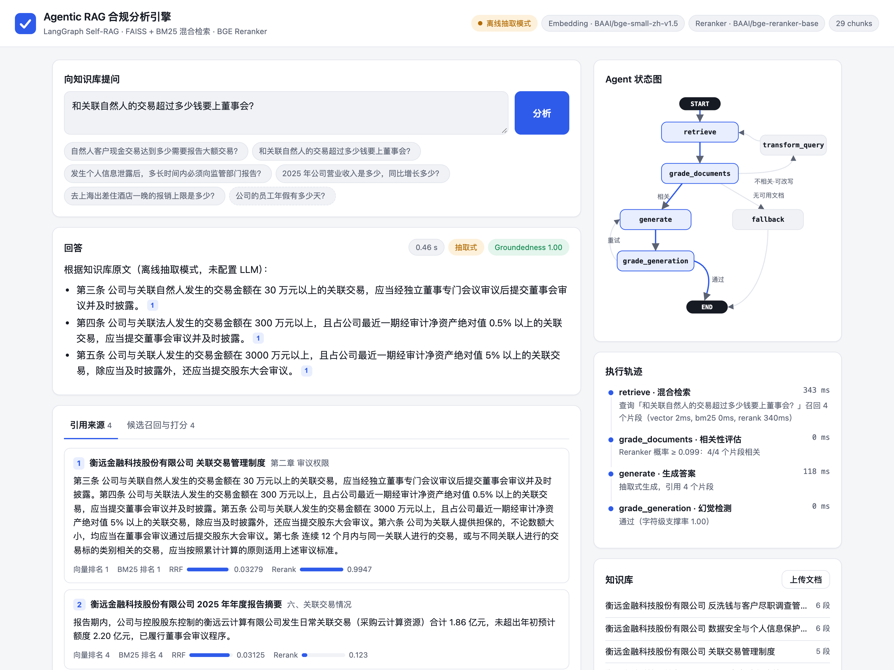
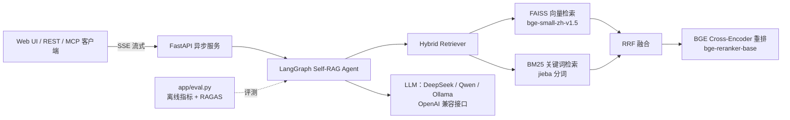
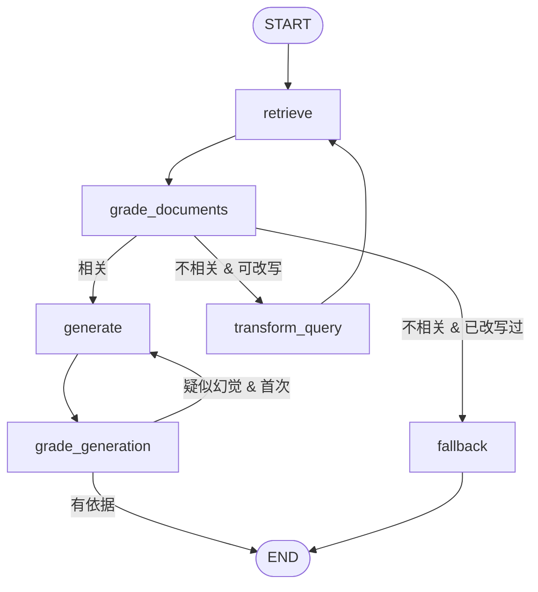

<div align="center">

# Agentic RAG Compliance Engine

**基于 LangGraph Self-RAG 的企业合规 / 财报智能分析微服务**

混合检索（FAISS + BM25 + RRF）· BGE Cross-Encoder 重排 · 相关性自评估与查询改写 · 幻觉检测与拒答 · 可视化前端 · 自动化评测 · Docker 一键部署

[](https://github.com/Henryhuangsice/agentic-rag-compliance-engine/actions/workflows/ci.yml)




</div>

## 为什么做这个项目

普通 RAG（“检索 → 拼进 Prompt → 生成”）在合规、法务、财报这类场景里有三个硬伤：

1. **召回不准**：用户口语化提问（“送客户礼物最多多少钱？”）和制度原文（“单件价值不得超过人民币 500 元”）字面差异大，纯向量或纯关键词都会漏。
2. **不会说“不知道”**：知识库里没有答案时，模型照样一本正经地编一个阈值或期限出来，在合规场景下这比不回答更危险。
3. **无法验证**：答案没有逐条出处，也没有量化指标证明改进是否有效。

本项目用 **Agentic Self-RAG** 解决这三点：检索后先由 Agent **评估相关性**，不相关就**改写查询重新检索**，仍然没有依据就**拒答**；生成后再做一次**幻觉检测**，并且每条结论都带 `[n]` 引用。所有改进都用评测脚本**量化对比**。

## 系统架构



### Agent 状态图（LangGraph）



| 节点 | LLM 模式（配置了 API Key） | 离线模式（无 Key，开箱即用） |
| --- | --- | --- |
| `retrieve` | FAISS + BM25 → RRF 融合 → BGE 重排，取 Top-4 | 同左 |
| `grade_documents` | LLM 逐段判断是否能回答问题 | Reranker 相关概率 ≥ 阈值 |
| `transform_query` | LLM 改写为制度原文风格的检索语句 | jieba 关键词抽取 |
| `generate` | LLM 生成，强制 `[n]` 引用 | 用 Reranker 从来源中抽取最相关的原句 |
| `grade_generation` | LLM 逐条核查陈述与资料是否一致、答案是否自相矛盾；不通过则严格模式重生成一次 | 字符级支撑率（answer 句子 bigram 覆盖率） |
| `fallback` | 拒答并给出建议 | 同左 |

> 离线模式让项目**不需要任何 API Key 就能完整跑起来、跑测试、跑评测**；配置 `LLM_API_KEY` 后自动切到 LLM 模式。任一 LLM 调用失败也会自动降级到离线逻辑，服务不会因为模型接口抖动而 500。

## 功能亮点

- **混合检索 + 重排**：向量检索补语义、BM25 补精确数字与术语（“200 万元”“L4”），用 Reciprocal Rank Fusion 融合，再由 Cross-Encoder 精排。全部基于 ONNX Runtime（fastembed），**不依赖 PyTorch / GPU**，镜像更小。
- **结构感知切块**：按 Markdown 标题切章节，章节内按中文句末标点打包，并在每个 chunk 前缀「文档标题 / 章节」，显著提升短条款的召回。
- **Self-RAG 闭环**：相关性评估 → 查询改写 → 拒答兜底 → 幻觉检测 → 带反馈的重生成，全部是 LangGraph 条件边。幻觉检测会逐条核对陈述并检查答案是否自相矛盾，未通过时把核查理由反馈给模型重写；重写后仍不通过，则改为直接摘录原文，绝不交付未通过核查的答案。
- **可视化前端**：实时高亮 Agent 走过的节点与边；时间线显示每个节点的耗时与判断依据；引用角标可点击跳转原文；“候选召回”页展示每个片段的向量排名、BM25 排名、RRF 分数、Rerank 分数以及是否被过滤。支持上传 PDF / Markdown / TXT 并自动重建索引。
- **流式 API**：`POST /api/v1/query/stream` 以 SSE 逐节点推送执行过程。
- **MCP Server**：把检索和 Agent 暴露为 MCP 工具，可直接接入 Claude Desktop / Cursor 等客户端。
- **可观测性**：设置 `LANGSMITH_*` 环境变量即可在 LangSmith 中查看每次调用的完整 Trace。
- **工程化**：Pydantic 配置、pytest（含 Fake LLM 覆盖 LLM 分支）、GitHub Actions CI、Docker 构建时预下载模型、Healthcheck、非 root 运行。

## 评测结果

### 离线模式（无 LLM）

评测集：`data/eval/qa_zh.jsonl`，26 个问题，其中 20 个可回答（覆盖 5 份文档、多为口语化改写的提问），6 个知识库中**没有答案**（用于测试拒答）。下表为本地实测结果（离线模式，未接 LLM，Apple Silicon CPU）：

| 模式 | Hit@4 | MRR | Context Precision | Answer Hit | No-Answer Acc. | Latency (s) |
| --- | --- | --- | --- | --- | --- | --- |
| Naive RAG（仅向量检索） | 0.95 | 0.90 | 0.90 | 0.85 | 0.00 | 0.12 |
| Hybrid（向量 + BM25，RRF） | 1.00 | 0.97 | 0.97 | 0.90 | 0.00 | 0.12 |
| Hybrid + BGE Rerank | 1.00 | 0.97 | 0.97 | 0.90 | 0.00 | 0.48 |
| **Agentic Self-RAG（本系统）** | 1.00 | 0.97 | 0.97 | 0.90 | 0.67 | 0.49 |

_Generated by `python -m app.eval` on 2026-11-04 · embedding `BAAI/bge-small-zh-v1.5` · reranker `BAAI/bge-reranker-base` · generator: offline extractive (no LLM) · 26 questions (20 answerable, 6 unanswerable)._

指标说明（离线、可复现，无需 API Key）：

- **Hit@4**：送入生成器的上下文中，至少有一段包含标注的关键事实。
- **MRR**：第一个包含关键事实的上下文的排名倒数。
- **Context Precision**：与 RAGAS 相同的按排名加权精确率，只是“相关”的判定用标注的关键事实代替 LLM 判断。Agentic 模式会把不相关片段过滤掉，所以这一项提升最明显。
- **Answer Hit**：最终答案是否包含全部关键事实。
- **No-Answer Acc.**：对知识库中没有答案的问题，系统是否正确拒答（普通 RAG 总会作答，所以为 0）。

结论与局限（如实说明）：

- **混合检索是检索质量提升的主要来源**：仅向量检索有 1 题完全漏召回（Hit@4 0.95），加入 BM25 后全部召回，MRR 从 0.90 升到 0.97。
- **Agentic 的核心收益是“该拒答时拒答”**：前三种模式对 6 个无答案问题全部硬答；Self-RAG 正确拒答 4 个（0.67），且可回答问题上的 Answer Hit 没有下降。
- **未拒答的 2 个是“近领域”难负例**：“2024 年第三季度营业收入”（知识库只有 2025 年报）和“离职提前多少天申请”（命中了报销时限条款）。Cross-Encoder 只能判断“话题相关”，判断不了“能否回答”，这类问题需要 LLM 评审（配置 `LLM_API_KEY` 后 `grade_documents` 自动改用 LLM 判定）。
- **Rerank 的代价是延迟**：CPU 上约 +0.35 s/次；语料很小（29 个 chunk）时排序提升有限，语料越大收益越明显。
- 相关性阈值是在这份小评测集上标定的（可回答问题最高分 ≥ 0.056，无答案问题最高分 ≤ 0.018），换语料后建议用 `python -m app.eval` 重新标定。
- 离线模式下答案是从原文抽取的，Groundedness 天然接近 1，不代表 LLM 生成的忠实度；LLM 生成的 Faithfulness 请用 `--ragas` 评测。

### 接入 LLM 后（智谱 GLM-4-Flash 免费版）

| 模式 | Hit@4 | MRR | Context Precision | Answer Hit | No-Answer Acc. | Latency (s) |
| --- | --- | --- | --- | --- | --- | --- |
| Naive RAG（仅向量检索） | 0.95 | 0.90 | 0.90 | 0.85 | 1.00 | 3.90 |
| Hybrid（向量 + BM25，RRF） | 1.00 | 0.97 | 0.97 | 0.95 | 1.00 | 3.51 |
| Hybrid + BGE Rerank | 1.00 | 0.97 | 0.97 | 0.90 | 1.00 | 4.95 |
| **Agentic Self-RAG（本系统）** | 1.00 | 1.00 | 1.00 | 0.95 | 1.00 | 10.74 |

RAGAS (LLM-judged):

| 模式 | Context Precision | Faithfulness | Context Recall |
| --- | --- | --- | --- |
| Naive RAG（仅向量检索） | 0.68 | 0.98 | 0.73 |
| Hybrid（向量 + BM25，RRF） | 0.71 | 0.95 | 0.77 |
| Hybrid + BGE Rerank | 0.74 | 0.98 | 0.77 |
| Agentic Self-RAG（本系统） | 0.77 | 0.83 | 0.91 |

_Generated by `python -m app.eval` on 2026-11-04 · embedding `BAAI/bge-small-zh-v1.5` · reranker `BAAI/bge-reranker-base` · generator: LLM `glm-4-flash` · 26 questions (20 answerable, 6 unanswerable)._

- **检索与上下文质量：Agentic 最好。** LLM 评审把不相关片段过滤掉后，MRR 和 Context Precision 都达到 1.00；RAGAS 的 Context Precision 从 0.68 升到 0.77，Context Recall 从 0.73 升到 0.91。
- **答案正确率：混合检索是主要来源。** Answer Hit 从 Naive 的 0.85 提到 Hybrid 的 0.95，Agentic 与 Hybrid 持平（0.95）。
- **拒答：接入 LLM 后四种模式都是 1.00。** 原因是生成 Prompt 本身要求“资料不足时说明资料未提及”，这 6 道无答案题对 LLM 来说比较明显，所以 Agentic 在离线模式下拒答率上的优势（0.67 vs 0）在这里体现不出来。它的价值在于：检索完全落空时根本不进入生成，以及生成后的事实核查。
- **Faithfulness：Agentic 最低（0.83，其他模式 0.95–0.98），如实报告。** 逐题拆解（数据来自加入反馈重试之前的一次运行，那次的总分同样是 0.83）发现两个原因：
  - 无答案题走 fallback 时上下文为空，RAGAS 评审对 4 次**完全相同**的拒答文本分别打了 1.00、1.00、0.25、0.00，这部分均分只有 0.71，属于评审噪声。
  - 可回答题的均分是 0.90，也低于对照组。较可能的原因是 LLM 评审通常只保留 1 个片段，答案里的解释性陈述失去了旁证。
- **这类数字的可信度有限**：评审模型就是 GLM-4-Flash 本身，每种模式只跑了一次，样本只有 26 题，几个百分点的差异在噪声范围内。
- **代价是延迟**：Agentic 每题要调用 3–4 次 LLM，平均 10.7 s，是对照组的 2–3 倍。
- **后续改进方向**：
  - fallback 时把候选片段也交给评审，避免空上下文导致的评审噪声。
  - 评审保留片段时设一个下限，例如至少 2 段。
  - 换一个更强、且与生成模型不同的模型来做 RAGAS 评审，并多次运行取平均。

完整的逐题分析、困难与取舍见 [技术报告](docs/TECHNICAL_REPORT.md)。

复现：

```bash
python -m app.eval                 # 离线指标，结果写入 results/benchmark_offline.md（配置 LLM 时为 benchmark_llm.md）
pip install -r requirements-eval.txt
python -m app.eval --ragas         # 额外运行 RAGAS（Faithfulness / Context Precision / Context Recall），需要 LLM_API_KEY
```

## 快速开始

### 方式一：Docker Compose（推荐）

```bash
git clone https://github.com/Henryhuangsice/agentic-rag-compliance-engine.git
cd agentic-rag-compliance-engine
cp .env.example .env          # 可选：填入 LLM_API_KEY（智谱 glm-4-flash 免费）；不填则为离线抽取模式
docker compose up -d --build
```

打开 <http://localhost:8000> 使用前端，<http://localhost:8000/docs> 查看 Swagger API 文档。

> 构建镜像时会预下载 Embedding 与 Reranker 模型（约 1.2 GB，最终镜像约 3 GB），之后容器启动不需要联网下载模型。如果所在网络访问 huggingface.co 较慢，可以在 `.env` 中设置 `HF_ENDPOINT=https://hf-mirror.com`，或者设置 `MODEL_SOURCE=modelscope` 让 Reranker 从魔搭社区下载。

使用本地模型（Ollama）：

```bash
docker compose --profile ollama up -d
docker compose exec ollama ollama pull qwen2.5:7b
# 在 .env 中设置 LLM_BASE_URL=http://ollama:11434/v1  LLM_MODEL=qwen2.5:7b  LLM_API_KEY=ollama
docker compose up -d api
```

### 方式二：本地运行

```bash
python3.11 -m venv .venv && source .venv/bin/activate
pip install -r requirements-dev.txt
cp .env.example .env
uvicorn app.main:app --reload
pytest -q                     # 测试使用哈希向量，不下载模型、不调用 LLM
```

## API

```bash
curl -s localhost:8000/api/v1/query \
  -H 'Content-Type: application/json' \
  -d '{"question": "和关联自然人的交易超过多少钱要上董事会？"}' | jq '.answer, .sources[0].title'
```

| 方法 | 路径 | 说明 |
| --- | --- | --- |
| `POST` | `/api/v1/query` | 运行 Agent，返回答案、引用来源、候选召回及打分、执行轨迹、groundedness、耗时 |
| `POST` | `/api/v1/query/stream` | 同上，SSE 流式推送每个节点的执行结果，最后推送完整结果 |
| `GET` | `/api/v1/documents` | 知识库文档列表及切块数 |
| `POST` | `/api/v1/documents` | 上传 `.md` / `.txt` / `.pdf`（≤10 MB），自动重建索引 |
| `GET` | `/api/v1/graph` | 导出 LangGraph 的 Mermaid 状态图 |
| `GET` | `/api/v1/health` | 健康检查与当前模型配置 |

### 作为 MCP Server 使用

```json
{
  "mcpServers": {
    "compliance-rag": {
      "command": "/path/to/.venv/bin/python",
      "args": ["-m", "app.mcp_server"],
      "cwd": "/path/to/agentic-rag-compliance-engine"
    }
  }
}
```

提供两个工具：`search_compliance_docs`（混合检索原文）和 `ask_compliance_agent`（完整 Self-RAG 问答）。

## 配置

全部通过环境变量或 `.env` 配置，完整列表见 [`.env.example`](.env.example) 与 [`app/config.py`](app/config.py)。

| 变量 | 默认值 | 说明 |
| --- | --- | --- |
| `LLM_BASE_URL` | `https://api.deepseek.com` | 任意 OpenAI 兼容接口（DeepSeek / 智谱 GLM / DashScope Qwen / Ollama / vLLM）。想零成本体验可用智谱免费的 `glm-4-flash`：`https://open.bigmodel.cn/api/paas/v4` |
| `LLM_MODEL` | `deepseek-chat` | 也可用 `deepseek-reasoner`（R1），`<think>` 内容会被自动剥离 |
| `LLM_API_KEY` | 空 | 为空时使用离线抽取模式 |
| `EMBEDDING_MODEL` | `BAAI/bge-small-zh-v1.5` | fastembed 支持的向量模型 |
| `RERANKER_MODEL` | `BAAI/bge-reranker-base` | 置空则关闭重排 |
| `RELEVANCE_THRESHOLD` | `0.03` | 离线模式下判定“相关”的 Reranker 概率绝对阈值（同时要求 ≥ 最高分 × `RELATIVE_THRESHOLD`=0.1） |
| `MAX_REWRITES` | `1` | 查询改写的最大轮数 |
| `MODEL_SOURCE` | `huggingface` | 设为 `modelscope` 从魔搭下载 Reranker |

## 项目结构

```text
agentic-rag-compliance-engine/
├── app/
│   ├── main.py          # FastAPI：REST + SSE + 静态前端
│   ├── agent.py         # LangGraph Self-RAG 状态机（6 个节点 + 2 组条件边）
│   ├── retriever.py     # FAISS + BM25 + RRF + Cross-Encoder 重排
│   ├── models.py        # Embedding / Reranker 后端（fastembed ONNX；测试用哈希向量）
│   ├── loader.py        # 文档加载（md/txt/pdf）与结构感知切块
│   ├── llm.py           # OpenAI 兼容 LLM 客户端
│   ├── eval.py          # 评测：离线指标 + RAGAS
│   ├── mcp_server.py    # MCP 工具服务
│   ├── config.py        # Pydantic Settings
│   └── static/          # 前端（原生 HTML/CSS/JS，无构建步骤）
├── data/
│   ├── docs/            # 示例知识库（虚构公司的合规制度与年报摘要）
│   └── eval/qa_zh.jsonl # 评测集（问题 / 参考答案 / 关键事实 / 是否可回答）
├── results/             # 评测输出
├── tests/               # pytest：切块、检索、Agent 路由、Fake LLM、API、SSE、上传
├── Dockerfile
├── docker-compose.yml
└── .github/workflows/ci.yml
```

## 设计取舍

- **为什么用 RRF 而不是加权求和**：向量相似度与 BM25 分数量纲不同，直接加权需要按语料调参；RRF 只看排名，几乎无需调参且稳健。
- **为什么离线模式用 Reranker 做相关性评估**：Cross-Encoder 的输出可以视为“问题–段落”相关概率，本身就是一个小型的判别式评审模型；用它做 `grade_documents` 不需要额外的 LLM 调用，延迟低。
- **为什么要拒答**：在合规场景中，编造一个“看起来合理”的金额阈值比不回答更危险。评测集中专门放了知识库无法回答的问题来衡量这一点。
- **为什么不用 PyTorch**：fastembed 基于 ONNX Runtime，CPU 推理足够快，Docker 镜像体积和冷启动时间都小得多。

## 路线图

- [ ] 多轮对话记忆（LangGraph checkpointer）
- [ ] Web Search 工具作为知识库外的兜底
- [ ] 表格 / 扫描件 PDF 的版面解析
- [ ] 文档级权限过滤

## 免责声明

`data/docs` 中的文档全部为演示用途虚构内容，“衡远金融科技股份有限公司”及其制度条款、财务数据均不真实存在，不构成任何法律或投资建议。

## License

[MIT](LICENSE)
