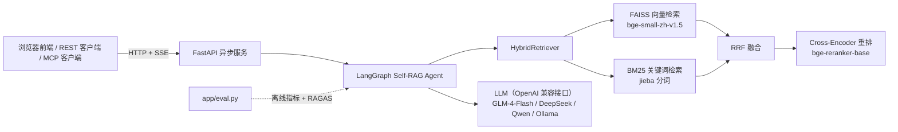
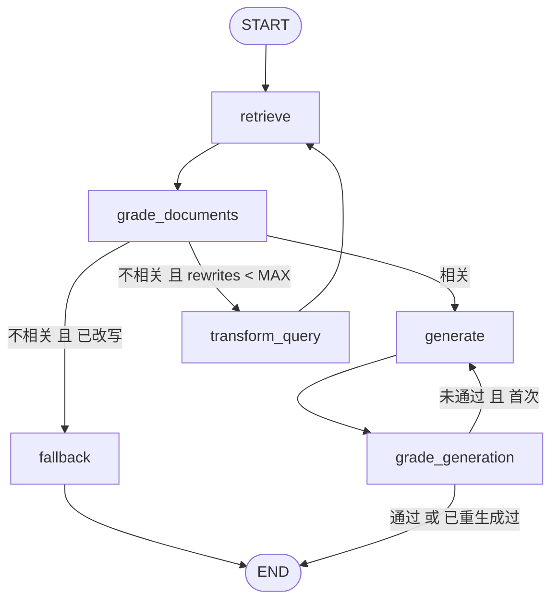

# 技术报告：Agentic RAG Compliance Engine

> 仓库：<https://github.com/Henryhuangsice/agentic-rag-compliance-engine>
> 报告日期：2026-11-04 ｜ 代码规模：Python 后端约 1,160 行，前端约 670 行，测试约 230 行（共 20 个用例）

---

## 1. 项目目标

面向企业合规、法务和财报文档的问答服务。核心要求有三条：

1. **答得准**：口语化提问（“送客户礼物最多多少钱？”）要能命中制度原文（“单件价值不得超过人民币 500 元”）。
2. **不编造**：知识库没有答案时要拒答；生成的答案要做事实核查。
3. **可验证**：每条结论带出处；改进效果要用评测数据证明，而不是凭感觉。

在这三条之外，项目还要能用 Docker 一键部署，提供可视化前端，并且在没有任何 API Key 的情况下也能完整运行和测试。

---

## 2. 总体架构



一次请求的数据流：

1. 前端通过 `POST /api/v1/query/stream` 提交问题，后端以 SSE 推送事件。
2. LangGraph 依次执行各节点，每个节点结束就向前端推一条 `step` 事件。前端据此高亮状态图中的节点和边，并在时间线上追加耗时与判断依据。
3. 图执行结束后推送 `result` 事件，内容包括答案、引用来源、全部候选片段及其四种打分、执行轨迹、groundedness 和总耗时。

---

## 3. 技术栈

| 层 | 选型 | 版本 | 选择理由 |
| --- | --- | --- | --- |
| Agent 编排 | LangGraph | 1.2.19 | 用状态机表达“评估 → 改写 → 重试 → 拒答”这类带条件分支和循环的流程，比链式调用清晰 |
| 文档抽象 | langchain-core | 1.7.4 | 只用 `Document` 数据结构，不引入整套 LangChain |
| 向量检索 | FAISS (`IndexFlatIP`) | 1.15.1 | 语料小，精确内积检索即可；向量先做 L2 归一化，内积等价于余弦相似度 |
| 关键词检索 | rank-bm25 + jieba | 0.2.2 / 0.42.1 | 中文必须先分词；用 `cut_for_search` 细粒度切分，并过滤停用词 |
| Embedding | BAAI/bge-small-zh-v1.5（fastembed，ONNX） | fastembed 0.9.1 | 中文效果好、体积小（约 95 MB）；ONNX Runtime 推理，不需要 PyTorch 或 GPU |
| 重排 | BAAI/bge-reranker-base（fastembed，ONNX） | — | 中英双语 Cross-Encoder；输出经 sigmoid 后可当作相关概率使用 |
| LLM 接入 | openai SDK（OpenAI 兼容协议） | 3.3.0 | 一套代码适配 DeepSeek、智谱 GLM、通义 Qwen、Ollama、vLLM |
| Web 服务 | FastAPI + Uvicorn | 0.162 / 0.54 | 原生 async、自动生成 Swagger、Pydantic 校验 |
| 配置 | pydantic-settings | 2.16.2 | 环境变量 / `.env` 统一管理，带类型校验 |
| 前端 | 原生 HTML / CSS / JS + 内联 SVG | — | 无构建步骤，由 FastAPI 直接托管；Docker 镜像不需要 Node |
| 工具协议 | MCP Python SDK（`MCPServer`） | 2.3.0 | 把检索和问答暴露给 Claude Desktop、Cursor 等 MCP 客户端 |
| 评测 | 自研离线指标 + RAGAS | ragas 0.4.3 | 离线指标零成本、可复现；RAGAS 提供 LLM 评审的 Faithfulness 等指标 |
| 可观测性 | LangSmith（可选） | — | 设置 `LANGSMITH_*` 环境变量即可，LangGraph 自动上报 Trace |
| 测试 | pytest + FastAPI TestClient | 9.2.0 | 测试使用哈希向量和 Fake LLM，不下载模型、不调用外部接口 |
| 部署 | Docker、Docker Compose、GitHub Actions | — | 构建时预下载模型、Healthcheck、非 root 用户；CI 跑测试和镜像构建 |
| 开发工具 | uv（虚拟环境 / 依赖安装）、gh CLI、Chrome DevTools Protocol（截图） | — | — |

---

## 4. 模块实现

### 4.1 文档加载与切块（`app/loader.py`）

- 支持 `.md`、`.txt`、`.pdf`（PDF 用 pypdf 抽取文本）。
- **结构感知切块**：
  1. 先按 Markdown 标题拆成章节，一级标题作为文档标题。
  2. 章节内部按中文句末标点（。！？；）切句。
  3. 再贪心打包成约 360 字的块，块与块之间保留约 60 字的整句重叠。
- 每个块前面加上 `【文档标题 / 章节】` 前缀。制度条款往往很短，例如“第六条……每半年至少复评一次”，单看这一句缺少主题词，加上前缀后，BM25 和向量模型都能拿到“反洗钱”“客户尽职调查”这样的上下文。

### 4.2 Embedding 与重排（`app/models.py`）

- `FastEmbedEmbedder`：查询前按 BGE 官方建议加上指令前缀（`为这个句子生成表示以用于检索相关文章：`），文档不加，输出向量统一做 L2 归一化。
- `CrossEncoderReranker`：对 (问题, 段落) 打分后用 sigmoid 转成 0–1 的概率。离线模式下的“相关性评估”就靠这个概率。
- `HashEmbedder`：字符 1–3 gram 的哈希向量，只用于测试和 CI，保证 CI 不需要下载约 1.1 GB 的模型。
- **ModelScope 下载通道**：设置 `MODEL_SOURCE=modelscope` 后，Reranker 从魔搭社区下载，支持断点续传，再通过 fastembed 的 `specific_model_path` 参数加载。原因见 6.3 节。

### 4.3 混合检索（`app/retriever.py`）

```
query ─┬─ FAISS top-10 ─┐
       └─ BM25  top-10 ─┴─ RRF 融合 ─ Cross-Encoder 重排 ─ top-4
```

- **RRF（Reciprocal Rank Fusion）**：`score(d) = Σ 1 / (60 + rank_r(d))`。向量相似度和 BM25 分数量纲不同，直接加权求和需要按语料调参；RRF 只看排名，几乎不需要调参，而且稳健。
- 每个候选片段的 `metadata` 都保留向量排名、BM25 排名、RRF 分数和 Rerank 分数，前端“候选召回与打分”页直接展示这四项，方便解释为什么召回了某个片段。
- 支持 `vector` / `bm25` / `hybrid` 三种模式，以及是否重排的开关，评测脚本据此构造对照组。
- 索引是进程级单例，加锁保护。上传文档后重建索引时复用已加载的模型，不重新加载。

### 4.4 Self-RAG Agent（`app/agent.py`）

**状态**（`GraphState`）：`question`、`query`（当前检索语句）、`documents`（召回结果）、`relevant`（评估后保留的片段）、`generation`、`rewrites`、`generations`、`grounded`、`groundedness`、`mode`、`trace`。其中 `trace` 使用 `Annotated[list, operator.add]`，每个节点追加一条记录，不会互相覆盖。

**状态图**：



**双模式**：每个节点都有 LLM 实现和离线实现。

| 节点 | LLM 模式 | 离线模式 |
| --- | --- | --- |
| `grade_documents` | 一次调用批量评估所有编号片段，返回 `{"relevant": [...]}` | Reranker 概率同时满足 ≥ 0.03 和 ≥ 最高分 × 0.1 |
| `transform_query` | 改写成制度原文风格的检索语句 | jieba 关键词抽取 |
| `generate` | 强制 `[n]` 引用，资料不足时必须说“资料未提及” | 用 Reranker 从来源中挑出最相关的 1–3 个原句 |
| `grade_generation` | 逐条陈述核查 + 自相矛盾检测（见 6.6 节）；不通过时把核查理由反馈给重新生成 | 字符 bigram 支撑率 ≥ 0.6 |

**自我修正与兜底**：`grade_generation` 判定不通过时，会把核查理由（例如“结论为 500 元，而要点中是 800 元”）连同上一版答案一起交给 `generate` 重写，这是 Self-Refine 式的反馈回路。如果重写后仍不通过，系统不会把未通过核查的答案交给用户，而是改为直接摘录资料原文（`mode = extractive_fallback`），前端显示“核查未通过 · 原文摘录”。

**容错**：任何一次 LLM 调用抛异常（限流、超时、JSON 解析失败）都会降级到对应的离线逻辑，接口不会返回 500。这一点有专门的单元测试（`test_llm_errors_fall_back_to_offline`）。

**可观测性**：`@traced` 装饰器统一给每个节点计时，并写入 `trace`。前端时间线和 API 响应里的 `trace` 字段都来自这里。

### 4.5 API 服务（`app/main.py`）

- 启动时通过 `lifespan` 在线程池中加载模型并建立索引，服务就绪后才开始接收流量。
- `POST /api/v1/query/stream` 使用 `app_graph.astream(stream_mode="values")`。每一步拿到完整状态，与上一步对比找出新增的 trace 条目推送给前端，最后推送完整结果。
- 文档上传接口用 `Path(name).name` 防止路径穿越，限制文件类型和 10 MB 大小，在线程池中重建索引。
- `GET /api/v1/graph` 导出 LangGraph 自动生成的 Mermaid 图。

### 4.6 前端（`app/static/`）

- **状态图**：手绘 SVG，每个节点和每条边都带 `data-node` / `data-edge` 属性。收到 `step` 事件时，把“上一节点 → 当前节点”这条边高亮，当前节点设为 active。查询改写的回环、拒答路径都能直观看到。
- **SSE 解析**：浏览器自带的 `EventSource` 只支持 GET，所以改用 `fetch` 加 `ReadableStream` 手动按 `\n\n` 切分事件，以便 POST JSON。
- **引用**：渲染答案时把 `[n]` 转成可点击的角标，点击后切换到“引用来源”页，滚动到对应片段并闪烁高亮。
- **其他**：支持亮色和暗色主题；`?q=问题` 链接可直接复现一次查询；上传文档后自动刷新知识库列表；离线模式和 LLM 模式在顶部状态栏有明显区分。

### 4.7 评测（`app/eval.py`）

评测集 `data/eval/qa_zh.jsonl` 共 26 题：20 题可回答（多数是口语化改写的问法），6 题知识库中没有答案。每道可回答题都标注了“关键事实”字符串。

四个对照组：

| 模式 | 检索 | 重排 | Agent |
| --- | --- | --- | --- |
| naive | 仅向量 | 否 | 否 |
| hybrid | 向量 + BM25（RRF） | 否 | 否 |
| hybrid_rerank | 向量 + BM25（RRF） | 是 | 否 |
| agentic | 向量 + BM25（RRF） | 是 | 完整 Self-RAG |

离线指标（不需要 API Key，可复现）：

- **Hit@4**：送入生成器的上下文中，至少有一段包含关键事实。
- **MRR**：第一个包含关键事实的上下文的排名倒数。
- **Context Precision**：与 RAGAS 相同的按排名加权精确率，只是“相关”的判定用关键事实匹配代替 LLM 判断。
- **Answer Hit**：最终答案包含全部关键事实。
- **No-Answer Acc.**：无答案问题上正确拒答的比例。拒答包括两种形式：走到 `fallback` 节点，或者答案中明确写出“资料未提及”。四种模式使用同一套判定规则。

`--ragas` 参数会额外调用 RAGAS 计算 Faithfulness、LLM Context Precision 和 Context Recall，评审模型与生成模型使用同一个接口。`--ragas-workers` 用来控制并发，适配免费接口的限流。

### 4.8 测试与 CI

20 个测试用例覆盖：

- 切块的结构和长度
- 停用词过滤
- RRF 排序
- 三种检索模式
- Agent 的两条主路径：正常生成，以及“改写 → 再检索 → 拒答”
- Fake LLM 模式下 LLM 调用的顺序
- 幻觉检测触发重生成
- LLM 异常时降级
- 引用格式归一化
- 全部 API（含 SSE 事件顺序、文档上传后可检索、拒绝非法文件类型）

GitHub Actions 运行两个任务：`pytest` 和 Docker 镜像构建。

---

## 5. 评测结果

### 5.1 离线模式（无 LLM，Apple M4 Pro CPU）

| 模式 | Hit@4 | MRR | Context Precision | Answer Hit | No-Answer Acc. | Latency (s) |
| --- | --- | --- | --- | --- | --- | --- |
| Naive RAG（仅向量检索） | 0.95 | 0.90 | 0.90 | 0.85 | 0.00 | 0.14 |
| Hybrid（向量 + BM25，RRF） | 1.00 | 0.97 | 0.97 | 0.90 | 0.00 | 0.15 |
| Hybrid + BGE Rerank | 1.00 | 0.97 | 0.97 | 0.90 | 0.00 | 0.57 |
| **Agentic Self-RAG** | 1.00 | 0.97 | 0.97 | 0.90 | **0.67** | 0.56 |

### 5.2 LLM 模式（智谱 GLM-4-Flash 免费版）

| 模式 | Hit@4 | MRR | Context Precision | Answer Hit | No-Answer Acc. | Latency (s) |
| --- | --- | --- | --- | --- | --- | --- |
| Naive RAG（仅向量检索） | 0.95 | 0.90 | 0.90 | 0.85 | 1.00 | 3.90 |
| Hybrid（向量 + BM25，RRF） | 1.00 | 0.97 | 0.97 | 0.95 | 1.00 | 3.51 |
| Hybrid + BGE Rerank | 1.00 | 0.97 | 0.97 | 0.90 | 1.00 | 4.95 |
| **Agentic Self-RAG（本系统）** | 1.00 | 1.00 | 1.00 | 0.95 | 1.00 | 10.74 |

RAGAS (LLM-judged):

| 模式 | Context Precision | Faithfulness | Context Recall |
| --- | --- | --- | --- |
| Naive RAG（仅向量检索） | 0.68 | 0.98 | 0.73 |
| Hybrid（向量 + BM25，RRF） | 0.71 | 0.95 | 0.77 |
| Hybrid + BGE Rerank | 0.74 | 0.98 | 0.77 |
| Agentic Self-RAG（本系统） | 0.77 | 0.83 | 0.91 |

_Generated by `python -m app.eval` on 2026-11-04 · embedding `BAAI/bge-small-zh-v1.5` · reranker `BAAI/bge-reranker-base` · generator: LLM `glm-4-flash` · 26 questions (20 answerable, 6 unanswerable)._

> 对照组三行来自完整运行；Agentic 一行是在加入“反馈式重试”后重新测量的（对照组不会走到这段代码）。

### 5.3 结论

离线模式：

- 混合检索是检索质量提升的主要来源（Hit@4 从 0.95 提到 1.00，MRR 从 0.90 提到 0.97）。
- Agentic 的核心收益是拒答（0 → 0.67），且没有损失答案正确率；剩下的 2 道难负例需要 LLM 才能判断。

LLM 模式：

- **检索与上下文质量：Agentic 最好。** LLM 评审把不相关片段过滤掉后，MRR 和 Context Precision 都达到 1.00；RAGAS 的 Context Precision 从 0.68 升到 0.77，Context Recall 从 0.73 升到 0.91。
- **答案正确率：混合检索是主要来源。** Answer Hit 从 Naive 的 0.85 提到 Hybrid 的 0.95，Agentic 与 Hybrid 持平（0.95）。
- **拒答：接入 LLM 后四种模式都是 1.00。** 原因是生成 Prompt 本身要求“资料不足时说明资料未提及”，这 6 道无答案题对 LLM 来说比较明显，所以 Agentic 在离线模式下拒答率上的优势（0.67 vs 0）在这里体现不出来。它的价值在于：检索完全落空时根本不进入生成，以及生成后的事实核查。
- **Faithfulness：Agentic 最低（0.83，其他模式 0.95–0.98），如实报告。** 逐题拆解（数据来自加入反馈重试之前的一次运行，那次的总分同样是 0.83）发现两个原因：
  - 无答案题走 fallback 时上下文为空，RAGAS 评审对 4 次**完全相同**的拒答文本分别打了 1.00、1.00、0.25、0.00，这部分均分只有 0.71，属于评审噪声。
  - 可回答题的均分是 0.90，也低于对照组。较可能的原因是 LLM 评审通常只保留 1 个片段，答案里的解释性陈述失去了旁证。
- **这类数字的可信度有限**：评审模型就是 GLM-4-Flash 本身，每种模式只跑了一次，样本只有 26 题，几个百分点的差异在噪声范围内。
- **代价是延迟**：Agentic 每题要调用 3–4 次 LLM，平均 10.7 s，是对照组的 2–3 倍。
- **后续改进方向**：
  - fallback 时把候选片段也交给评审，避免空上下文导致的评审噪声。
  - 评审保留片段时设一个下限，例如至少 2 段。
  - 换一个更强、且与生成模型不同的模型来做 RAGAS 评审，并多次运行取平均。

---

## 6. 实施过程中遇到的困难与解决方案

下面按时间顺序记录真实遇到的问题。这些问题大多是做出一个“能用的”工程项目必须跨过的坎，也适合在面试中展开讲。

### 6.1 运行环境：系统 Python 是 3.14

**现象**：系统自带 Python 3.14，faiss、onnxruntime 等库对新版本的二进制包支持不稳定。
**解决**：用 `uv` 创建 Python 3.11 虚拟环境，Dockerfile 和 CI 也统一使用 3.11。

### 6.2 依赖冲突：RAGAS 和 MCP 的版本不兼容

- **RAGAS**：ragas 0.4.3 在导入时引用了 `langchain_community.chat_models.vertexai`，而这个模块在 langchain-community 0.4 中已被删除，直接 `import ragas` 就会报错。我在一个隔离环境里验证后，把 langchain-community 固定为 0.3.31，并把 RAGAS 相关依赖单独放进 `requirements-eval.txt`，避免主服务镜像被评测依赖拖大。
- **MCP**：MCP SDK 2.x 把 `FastMCP` 改名为 `MCPServer`，网上大多数教程的写法会直接报错。我查看新版 API 签名后改用 `MCPServer`。

### 6.3 模型下载：Hugging Face 无法访问

**现象**：
- 直连 huggingface.co 超时。
- 换成 hf-mirror.com 后，约 1 GB 的 Reranker 下载速度只有约 127 KB/s，而且在 64 MB 处停住。

**排查**：用 curl 分别对 hf-mirror 和 ModelScope 测速：hf-mirror 约 0.13 MB/s，ModelScope 约 2.2 MB/s，相差约 17 倍。
**解决**：在 `models.py` 里实现 ModelScope 下载通道：

- 逐个文件下载，写入 `.part` 临时文件，支持 HTTP Range 断点续传。
- 下载完成后通过 fastembed 的 `specific_model_path` 参数加载本地目录。
- Dockerfile 和 docker-compose 都暴露了 `MODEL_SOURCE`、`HF_ENDPOINT` 两个构建参数，国内用户可以直接使用。

**附带问题**：复制 fastembed 的缓存目录时，模型文件只剩 0 字节。原因是 Hugging Face 缓存中的 blob 是指向共享目录的符号链接，普通复制只复制了链接本身。改用 `cp -RL` 解引用复制后解决。

### 6.4 相关性阈值：凭经验定的值不可用

**现象**：初始阈值设为 0.15，结果“哪个业务板块收入占比最高”这类可回答问题的最高 Rerank 分数只有 0.056，会被误判为不相关。
**解决**：先统计评测集上的分数分布，再根据数据定阈值：

| 问题类型 | 最高 Rerank 分数 |
| --- | --- |
| 可回答问题 | 最低为 0.056 |
| 无答案问题 | 最高为 0.018 |

据此把绝对阈值定为 0.03，同时要求不低于“最高分 × 0.1”，用来过滤与最佳片段相差悬殊的噪声片段。README 中明确说明这个阈值是在这份小评测集上标定的，换语料后需要重新标定。

### 6.5 一个逻辑 Bug：改写查询后评估标准被带偏

**现象**：第一版评测中，Agentic 模式对无答案问题的拒答率是 0，和普通 RAG 一样。
**排查**：逐节点打印“员工年假有多少天”的执行轨迹：

1. 第一轮评估时，0/4 个片段相关，判断正确。
2. 离线改写把问题变成关键词串“员工 年 假 天”。
3. 第二轮检索后，Reranker 用这个关键词串打分，“礼品与招待”片段得到 0.046，超过阈值，被当成相关片段。

**根因**：评估是否相关时，用的是改写后的查询，而不是用户的原始问题。关键词串语义很稀薄，噪声片段的分数因此被抬高。
**修复**：改写之后，`grade_documents` 用原始问题对候选片段重新打分。修复后拒答率从 0 提升到 0.67，可回答问题的 Answer Hit 没有下降。

剩下 2 道没有拒答的题属于“近领域难负例”：“2024 年第三季度营业收入”命中了 2025 年报，“离职需提前多少天申请”命中了报销时限条款。Cross-Encoder 只能判断“话题相关”，判断不了“能不能回答”，这类问题需要 LLM 来评审。

### 6.6 免费小模型 GLM-4-Flash 的三个“怪癖”

接入真实 LLM 后发现的问题，都是 Fake LLM 测试覆盖不到的：

1. **JSON 格式不规范**：偶尔输出 Python 字面量，例如 `{"ok": True}`。
   **解决**：`chat_json` 先尝试 `json.loads`，失败后用 `ast.literal_eval` 兜底。
2. **引用格式五花八门**：会写成 `[编号：1]`、`【1】`、`[1, 2]`，前端无法渲染成角标。
   **解决**：Prompt 中给出引用格式示例，同时在服务端用 `normalize_citations` 统一转成 `[1][2]`，并补了单元测试。
3. **最严重的问题：答案自相矛盾，自检却通过了**。
   - 对“去上海出差住酒店一晚的报销上限是多少”，模型的结论句写 **500 元**，要点里写 **800 元**（800 元是正确答案），幻觉检测却给出 score = 1.00，判定通过。
   - 用真实检索上下文复现：旧的核查 Prompt 3 次都判定通过。
   - 新的 Prompt 要求逐条列出陈述（包括结论句）并标注是否被资料支持，同时显式检查结论与要点是否一致。改用新 Prompt 后 3 次都判定不通过，从而触发严格模式重新生成。
   - 新 Prompt 输出的 `score` 有时是百分数（如 66.67），代码里增加了归一化，把分数限制在 0–1 之间。

   - **第二轮问题**：检查能拦住错误答案之后，又发现重新生成时模型还是写出同样的 500 元。原因是重试的 Prompt 只说了“上一版有问题，请更严格”，没告诉模型具体错在哪里。
   - **解决**：把核查理由和上一版答案一起放进重试 Prompt。复测 2 次，重试后的答案都改成了正确的 800 元，并通过了核查。
   - **兜底**：如果重试后仍不通过，就改用原文摘录作答。原则是“宁可只给原文，也不交付没通过核查的答案”。这条路径有单元测试覆盖（`test_failed_check_retries_with_feedback_then_falls_back_to_sources`）。

   **经验**：用同一个小模型自己检查自己时，宽泛的指令（“判断每个事实是否有依据”）很容易被模型敷衍过去；把任务拆成可逐条核对的结构化步骤，效果明显更好。

### 6.7 评测公平性：拒答不止一种形式

**现象**：LLM 模式下，模型会直接回答“资料未提及 2024 年第三季度的营业收入”。这本质上也是拒答，但最初只统计了走 `fallback` 节点的情况。
**解决**：用同一个正则（`资料/知识库 … 未提及/未包含/未检索到`）判定四种模式的拒答。这样也揭示了一个值得如实报告的现象：只要生成 Prompt 里要求“资料不足时说明未提及”，即使是 Naive RAG 也能在这类明显的无答案问题上拒答。

### 6.8 工程细节类问题

| 问题 | 原因 | 解决 |
| --- | --- | --- |
| 测试结果受执行顺序影响 | 上传测试会往共享语料目录写入文件，其他测试的断言因此失败 | 测试改用临时目录中的语料副本，断言改成“包含原有 5 份文档” |
| Docker 构建偶尔在 `pip install` 失败 | 网络瞬时错误 | 重试后成功；CI 中构建正常 |
| 无头 Chrome 截图停在加载状态 | `--virtual-time-budget` 和 `--timeout` 使用虚拟时间，等不到真实的 SSE 网络响应 | 写了一个 CDP（Chrome DevTools Protocol）脚本：打开页面，真实等待 8 秒后再截图 |
| 预下载模型的镜像有 5.35 GB | `docker history` 显示 1.23 GB 的模型层出现了两次：Dockerfile 末尾的 `chown -R` 改了模型文件的属主，Docker 只能把这些文件整层复制一份 | 先创建非 root 用户并切换过去，再以该用户身份下载模型，代码用 `COPY --chown` 复制。镜像降到 3.07 GB，只剩一层模型 |
| 第一次重建镜像后体积没变 | 用 `-q` 静默构建失败了，但旧镜像仍然带着同一个 tag，冒烟测试实际测的是旧镜像 | 用可见输出重新构建并核对 `docker history`。教训：验证构建结果要看镜像 ID 或层信息，不能只看 tag |
| 创建 GitHub 仓库时 `gh` 报 502 | GitHub API 服务端错误 | 仓库实际已创建；手动添加 remote 后推送成功。设置 topics 的接口持续返回 502，留给用户手动添加 |
| DeepSeek 返回 402 | 账户余额不足 | 改用智谱 GLM-4-Flash 免费版 |
| 智谱返回 401 | Key 只复制了一半（32 位，缺少 `.` 之后的部分） | 在不读取 Key 内容的前提下检查了长度和格式，定位到截断问题 |

---

## 7. 局限与后续计划

- **语料规模小**：只有 5 份文档、29 个切块，检索指标接近上限，重排的收益没有完全体现出来。可以引入更大的公开语料，例如真实上市公司年报，做压力测试。
- **评测集小**：26 题，阈值也是在这份评测集上标定的，存在过拟合风险。需要划分标定集和测试集。
- **延迟**：LLM 模式下每个问题要调用 3–4 次 LLM（评估、生成、核查，可能还有改写），免费接口上单题约 4–20 秒。可以优化的方向：小模型做评估、大模型做生成；并行化；流式输出生成内容。
- **功能**：多轮对话记忆（LangGraph checkpointer）、Web Search 兜底、表格和扫描件 PDF 解析、文档级权限过滤。

---

## 8. 验收清单

| # | 验收项 | 操作 | 预期结果 |
| --- | --- | --- | --- |
| 1 | 仓库与 CI | 打开 GitHub 仓库首页和 Actions 页 | README 正常渲染（含截图和 Mermaid 图）；最新一次 CI 的 `test` 和 `docker` 两个任务都是绿色 |
| 2 | 前端：正常问答 | 打开 <http://localhost:8000>，点击示例问题“和关联自然人的交易超过多少钱要上董事会？” | 状态图依次高亮 retrieve → grade_documents → generate → grade_generation → END；答案包含“30 万元”；引用角标可以点击跳转到原文 |
| 3 | 前端：拒答 | 点击虚线框中的示例“公司的员工年假有多少天？” | 状态图走 transform_query 回环后进入 fallback；答案为拒答提示 |
| 4 | 前端：可解释性 | 切换到“候选召回与打分”页 | 每个片段显示向量排名、BM25 排名、RRF 分数、Rerank 分数，以及“相关 / 已过滤”标签 |
| 5 | 文档上传 | 上传一个包含“年假 15 天”的 .md 文件，再问一次年假问题 | 知识库列表出现新文档；答案引用该文件 |
| 6 | API | 打开 <http://localhost:8000/docs> | Swagger 中列出 6 个接口，可以直接试调 |
| 7 | 单元测试 | 在项目目录运行 `.venv/bin/pytest -q` | 20 passed |
| 8 | 评测复现 | 运行 `LLM_API_KEY= .venv/bin/python -m app.eval` | 输出的离线指标与 5.1 节一致（延迟数值会因机器不同略有差异） |
| 9 | 全新环境部署（最终验收） | 在另一个目录执行 `git clone` → `cp .env.example .env` → `docker compose up -d --build`。国内网络请先在 `.env` 中设置 `MODEL_SOURCE=modelscope` 和 `HF_ENDPOINT=https://hf-mirror.com` | 镜像构建时会下载约 1.1 GB 模型；完成后访问 <http://localhost:8000> 可正常问答 |

> 第 9 项已在本机验证：使用 `MODEL_SOURCE=modelscope`、`HF_ENDPOINT=https://hf-mirror.com` 构建出带模型的镜像（3.07 GB）。容器在禁止访问 Hugging Face（`HF_HUB_OFFLINE=1`）的情况下启动，健康检查为 healthy，以非 root 用户运行，问答正常。
